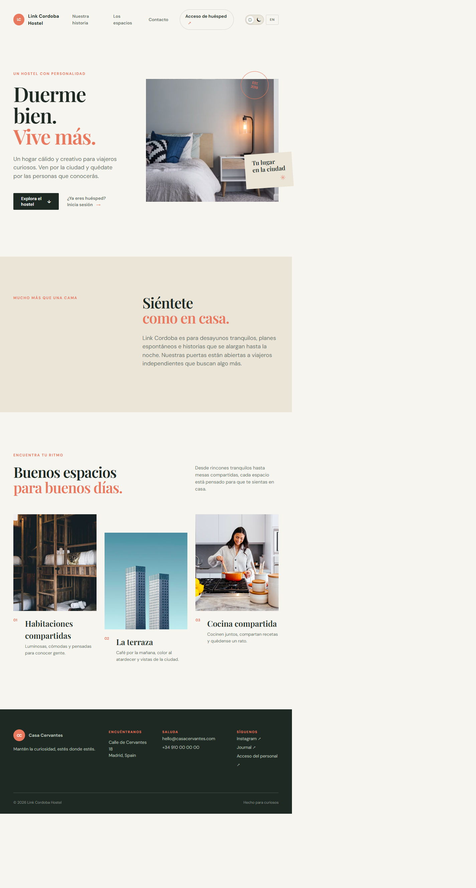
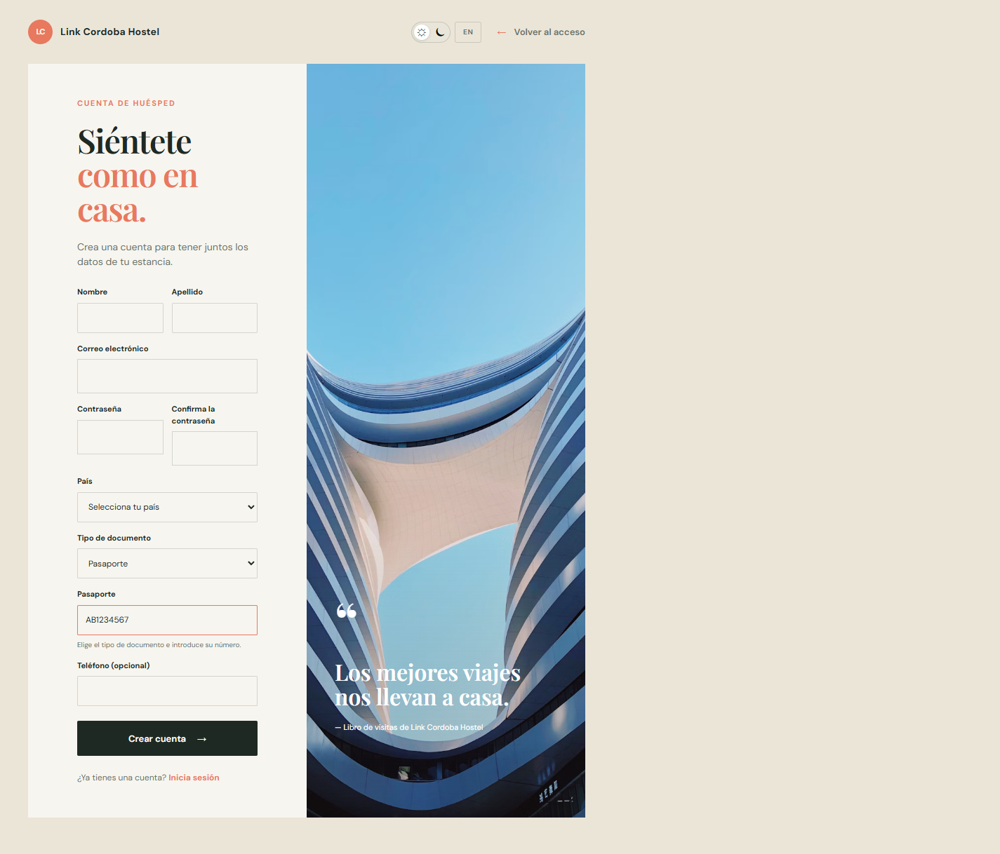
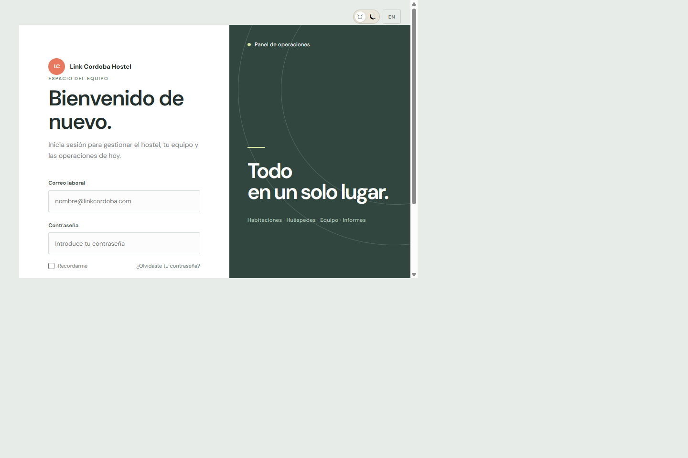

# Link Cordoba Hostel

Prototipo de gestión para un hostel. Combina una interfaz web estática, una API en ASP.NET Core y una base de datos SQL Server. Actualmente están conectados los flujos de autenticación, registro de huéspedes y acceso al portal privado; las pantallas de operación del hostel son, en su mayoría, demostrativas.

## Vistas del proyecto

| Sitio público | Registro de huésped |
| --- | --- |
|  |  |

| Acceso de huésped | Acceso del personal |
| --- | --- |
|  |  |

Las capturas muestran la interfaz del prototipo. La disponibilidad de datos y operaciones depende de que la API y SQL Server estén configurados y en ejecución.

## Tecnologías

- **Frontend:** HTML, CSS y JavaScript sin framework, en `frontend/`.
- **Backend:** ASP.NET Core Web API sobre .NET 8, en `APIHostel/`.
- **Persistencia:** SQL Server y Entity Framework Core.
- **Autenticación:** tokens JWT con roles y contraseñas almacenadas mediante BCrypt.

## Requisitos

- .NET SDK 8.
- SQL Server local o accesible desde la máquina.
- Un navegador moderno.

## Puesta en marcha local

### 1. Crear la base de datos

Ejecuta [`database/DBHostel.sql`](database/DBHostel.sql) **una sola vez** en SQL Server Management Studio o en otra herramienta de SQL Server. El script crea la base `HOTEL_BOOKINGS`, sus tablas e índices, y los catálogos iniciales.

Para completar el catálogo de países, ejecuta después [`database/SeedMissingCountries.sql`](database/SeedMissingCountries.sql). Este segundo script se puede repetir: omite los nombres ya existentes.

Para cargar datos de prueba de tipos, comodidades, habitaciones y camas, ejecuta [`database/SeedRoomsAndBeds.sql`](database/SeedRoomsAndBeds.sql) después de crear la base. El script completa los catálogos faltantes y se puede ejecutar varias veces sin duplicar registros.

La API usa por defecto la conexión local integrada definida en `APIHostel/appsettings.json`:

```text
Server=localhost;Database=HOTEL_BOOKINGS;Trusted_Connection=True;TrustServerCertificate=True;
```

Si tu instancia de SQL Server es distinta, configura `ConnectionStrings:HostelConnection` en `APIHostel/appsettings.Development.json` o mediante la configuración de ASP.NET Core. No guardes credenciales reales en el repositorio.

### 2. Iniciar la API

Desde la raíz del repositorio:

```powershell
dotnet run --project .\APIHostel\APIHostel.csproj --launch-profile http
```

El perfil local escucha en `http://localhost:5159`. La documentación interactiva de los endpoints está en [http://localhost:5159/swagger](http://localhost:5159/swagger).

En entorno `Development`, la API habilita CORS para facilitar el uso del frontend local. La clave JWT de desarrollo se genera al iniciar la API; por eso, al reiniciarla, las sesiones activas dejan de ser válidas.

### 3. Abrir el frontend

Abre las páginas de `frontend/` directamente en el navegador o sírvelas desde un servidor estático, por ejemplo con Live Server en Visual Studio Code. Las llamadas del navegador están configuradas para la API local en `http://localhost:5159`.

Páginas principales:

| Página | Ruta |
| --- | --- |
| Sitio público | `frontend/index.html` |
| Acceso de huéspedes | `frontend/login.html` |
| Registro de huéspedes | `frontend/guest-register.html` |
| Portal de huéspedes | `frontend/guest-portal.html` |
| Acceso del personal | `frontend/employee-login.html` |
| Panel del personal | `frontend/employee-dashboard.html` |
| Gestión de habitaciones | `frontend/employee-rooms.html` |
| Solicitudes de reserva | `frontend/employee-reservation-requests.html` |

El acceso al panel requiere iniciar sesión con una cuenta de personal válida. El script SQL crea los roles, pero no inserta usuarios ni contraseñas; no se crean credenciales de prueba automáticamente.

## Funcionalidades implementadas

### Interfaz

- Sitio público responsive y páginas separadas para huéspedes y personal.
- Cambio entre español e inglés y selector de tema claro/oscuro.
- Formularios con validaciones básicas y mensajes de resultado.
- Selector de país cargado desde la API; el registro muestra la bandera correspondiente a cada país del catálogo.
- Selector de tipo de documento: el formulario cambia entre DNI y pasaporte y envía el valor al campo apropiado.

### API y operaciones conectadas

| Endpoint | Función |
| --- | --- |
| `POST /api/Auth/Login` | Valida las credenciales y devuelve un JWT con el rol de la cuenta. |
| `GET /api/Auth/Countries` | Devuelve los países guardados en SQL Server para el formulario de registro. |
| `POST /api/Auth/RegisterGuest` | Crea la cuenta y el perfil de huésped; valida el país y los documentos, y guarda la contraseña con BCrypt. |
| `GET /api/Auth/HasAdministrator` | Indica si existe una cuenta administradora activa. |
| `POST /api/Auth/RegisterInitialAdministrator` | Crea la cuenta administradora inicial únicamente si no existe otra activa. |
| `GET /api/Auth/Me` | Devuelve los datos de la cuenta autenticada que utiliza el panel. |
| `POST /api/Auth/RegisterEmployee` | Permite a un administrador crear cuentas de personal con rol de administrador o recepción. |
| `GET`, `POST /api/Users` | Lista las cuentas activas y permite a un administrador crear cuentas de equipo o huéspedes. |
| `GET`, `PUT`, `DELETE /api/Users/{id}` | Consulta, modifica o da de baja cuentas; las contraseñas se guardan con BCrypt. |
| `GET /api/GuestPortal` | Devuelve el perfil y las reservas del huésped autenticado. |
| `POST /api/GuestPortal/Reservations/{id}/Cancel` | Cancela reservas futuras pendientes o confirmadas del propio huésped, conservando el historial. |
| `GET /api/GuestPortal/Availability?checkIn=...&checkOut=...` | Consulta habitaciones activas y camas disponibles para las fechas solicitadas. |
| `POST /api/GuestPortal/Reservations` | Crea una solicitud pendiente y asigna camas disponibles a la cuenta autenticada. |
| `GET /api/Rooms` y `GET /api/Rooms/Lookups` | Lista habitaciones activas y catálogos para el módulo del personal. |
| `POST /api/Rooms`; `PUT` y `DELETE /api/Rooms/{id}` | Crea, modifica o da de baja habitaciones; las bajas son lógicas y conservan el historial. |
| `GET /api/Reservations` | Devuelve las solicitudes pendientes para el personal autorizado. |
| `POST /api/Reservations/{id}/Decision` | Confirma o rechaza una solicitud pendiente. |

Los tokens de acceso duran 30 minutos y se guardan en `sessionStorage`. El acceso al portal está restringido por rol en la API, y las operaciones del panel vuelven a validar la cuenta en el servidor.

### Modelo de datos

El esquema incluye usuarios y roles, huéspedes y países, habitaciones, camas y estados, servicios, reservas, estados de reserva y la relación entre reservas y camas. Incluye claves foráneas, restricciones e índices. El total de una reserva se calcula mediante la vista `dbo.V_RESERVATION_TOTALS`.

## Funcionalidades conectadas

- **Habitaciones del personal:** la pantalla de gestión permite crear, editar y dar de baja habitaciones. La capacidad se gestiona creando o desactivando camas; no se puede reducir si están asignadas a reservas pendientes o confirmadas.
- **Solicitud de huéspedes:** el portal permite consultar disponibilidad por fechas y enviar solicitudes para una habitación y cantidad de camas. La API asigna las camas y deja la reserva pendiente de revisión.
- **Gestión de solicitudes:** el personal puede confirmar o rechazar solicitudes pendientes desde `frontend/employee-reservation-requests.html`.
- **Gestión de usuarios:** desde el sidebar, administradores y empleados se gestionan en Equipo, y los huéspedes en Huéspedes; ambos listados permiten ordenar por nombre y administrar las cuentas.

## Pendiente de implementar

- **Operación de reservas del personal:** el formulario de alta manual y el calendario todavía muestran contenido de ejemplo.
- **Gestión de camas:** administrar individualmente estados como mantenimiento o fuera de servicio desde una pantalla del personal.
- **Dashboard operativo:** sustituir estadísticas, agenda, ocupación, llegadas y salidas de ejemplo por datos de la API.
- **Módulos del panel:** informes y configuración todavía no tienen una implementación funcional completa.
- **Cuenta y autenticación:** implementar recuperación y cambio de contraseña. La casilla “Recordarme” y otros enlaces de acceso/ayuda todavía no gestionan esas acciones.
- **Operación productiva:** definir una clave JWT estable mediante configuración segura, endurecer CORS, HTTPS y la gestión de secretos, y preparar despliegue, copias de seguridad y observabilidad.

Para ver el mapa técnico y la propuesta de organización del backend, consulta [`docs/ARQUITECTURA.md`](docs/ARQUITECTURA.md).

## Estructura del repositorio

```text
APIHostel/              API ASP.NET Core, controladores, entidades y acceso a datos
database/               Esquema SQL y carga idempotente del catálogo de países
docs/                   Documentación y capturas de pantalla
frontend/               Páginas HTML, estilos compartidos y scripts del navegador
APIHostel.sln            Solución de Visual Studio
```
